# Reporting data dictionary

Every `rpt_` view that RivetCore creates for reporting and BI tools (Power BI, Excel, Grafana, any SQL client). Status: phase 2 of [#91](https://github.com/TheTractorHacker/rivet-core/issues/91). Guide: [POWER_BI.md](POWER_BI.md). Design: [../design/reporting.md](../design/reporting.md).

The tables of the views below (columns, types, meaning) are **generated from the view catalog** (`src/Reporting/ReportingCatalog.php`) by `php scripts/reporting-docs.php`, and a test fails when this file is stale. The text around them is written by hand.

## Rules every view follows

* **Frozen columns.** The column list and order of each view is a public contract (`tests/Fixtures/reporting_views.json`, enforced by a test). A column can be **added at the end** of a view on purpose, in a release; a column is never renamed, reordered, retyped or removed within a major version. Reports built on a view keep working after an upgrade.
* **UTC.** Every timestamp is UTC (MariaDB / MySQL `datetime`; PostgreSQL `timestamptz` read with the session in UTC, which the reporting role sets). The one exception is `rpt_audit_events.created_at`, which is in the database server's time zone (UTC on a server set up as recommended). See "Time zones" in the [Power BI guide](POWER_BI.md#time-zones).
* **Ids.** `device_id`, `client_id`, `site_id` and `asset_id` are the ids of the control database, the same in every view and in the RivetIT / RivetMSP application. Client, site and asset **names** belong to the edition and are not in these views (see "Not in Core" below).
* **`client_id` on every row** of a client-scoped view, so a report can be scoped per client. The exception is explained under the entity diagram (PostgreSQL copy of the metric, check and software views).
* **Flags** are integers, `1` or `0` (NULL where unknown). **Durations** are seconds (`_s`). **Sizes** are bytes (`_bytes`).
* **No secrets and no free text.** An allow-list of columns per view; never `SELECT *`. Not exposed anywhere: tokens, hashes, encrypted or sealed columns, signing keys, passwords, connection strings, IP addresses, MAC addresses, serial numbers, user names, script output, command lines, registry or file values, check or alert text, change-monitor values (counts and types only), log text. A test scans every column name and every column the views read for these words.
* **Rows are not guaranteed to exist forever.** The views show what the tables hold: retention (`retention_days`, `check_history_days`, the 14 day hourly and 400 day daily tiers, ...) deletes old rows. A BI dataset that needs more history than the tables keep must store it itself (Power BI incremental refresh does).

## Where the data lives

```
                      CONTROL DATABASE (MariaDB / MySQL)                     POSTGRESQL RMM STORE (only when data_store = postgres)
 ┌──────────────────────────────────────────────────────────────┐   ┌─────────────────────────────────────────────────────┐
 │ rpt_devices            rpt_device_groups     rpt_device_tags │   │ rpt_device_health_hourly   rpt_device_health_daily  │
 │ rpt_alerts             rpt_check_status      rpt_audit_events│   │ rpt_check_results          rpt_change_events        │
 │ rpt_patch_compliance   rpt_patch_updates     rpt_software_inventory │ rpt_patch_history          rpt_software_changes     │
 │ rpt_hypervisor_hosts   rpt_hypervisor_vms                    │   └─────────────────────────────────────────────────────┘
 │ + the six "hot" views, over the control copy of the hot      │      the hot views exist in BOTH places; with data_store = postgres
 │   tables (live while data_store = mariadb; a frozen leftover  │      the PostgreSQL ones are the live ones
 │   after a move to PostgreSQL: do not report on it then)      │
 └──────────────────────────────────────────────────────────────┘
```

* **`data_store = mariadb` (the default):** one database, one connection in Power BI, all 17 views, every client-scoped view carries `client_id`.
* **`data_store = postgres`:** the 11 control views stay in the control database; the 6 hot views (health hourly and daily, check results, change events, patch history, software changes) are live in PostgreSQL. Power BI needs **two connections** and relates the model on `device_id` / `asset_id` / `client_id`. The PostgreSQL store has no device table to join, so:
  * `rpt_change_events` and `rpt_patch_history` keep their `client_id` (the hot tables carry it); a change-event row written before the denormalisation can have `client_id` NULL there and then belongs to no client's filter;
  * `rpt_device_health_hourly` / `_daily` have **`asset_id` only** (the metric tables are keyed by the edition's asset); `rpt_check_results` and `rpt_software_changes` have **`device_id` only**. Relate them to `rpt_devices` on `asset_id` or `device_id` and scope by client there ([Power BI guide, row-level security](POWER_BI.md#row-level-security-per-client)).

## Entity diagram

```mermaid
erDiagram
    rpt_devices ||--o{ rpt_device_groups : device_id
    rpt_devices ||--o{ rpt_device_tags : device_id
    rpt_devices ||--o{ rpt_device_health_hourly : "asset_id (device_id in MariaDB)"
    rpt_devices ||--o{ rpt_device_health_daily : "asset_id (device_id in MariaDB)"
    rpt_devices ||--o{ rpt_alerts : device_id
    rpt_devices ||--o{ rpt_check_status : device_id
    rpt_devices ||--o{ rpt_check_results : device_id
    rpt_devices ||--o| rpt_patch_compliance : device_id
    rpt_devices ||--o{ rpt_patch_updates : device_id
    rpt_devices ||--o{ rpt_patch_history : device_id
    rpt_devices ||--o{ rpt_software_inventory : device_id
    rpt_devices ||--o{ rpt_software_changes : device_id
    rpt_devices ||--o| rpt_hypervisor_hosts : device_id
    rpt_devices ||--o{ rpt_hypervisor_vms : "device_id = host_device_id"
    rpt_devices ||--o{ rpt_change_events : device_id
    rpt_devices {
        int device_id PK
        int client_id
        int site_id
        int asset_id
        text status
    }
    rpt_alerts {
        int alert_row_id PK
        int alert_id
        int device_id FK
        int client_id
        text check_name
    }
    rpt_device_health_hourly {
        int asset_id
        text metric_name
        datetime hour_start
        double avg_value
    }
    rpt_audit_events {
        int audit_id PK
        text event_type
    }
```



`rpt_audit_events` stands alone: audit events carry no client, so it has no relationship and no `client_id`. **Do not grant it to a per-client account or dataset.**

The same in plain text (`1 --- *` = one to many):

```
 clients (edition) 1 ---* rpt_devices 1 ---* rpt_device_groups, rpt_device_tags, rpt_alerts, rpt_check_status, rpt_check_results,
                                      |         rpt_patch_updates, rpt_patch_history, rpt_software_inventory, rpt_software_changes,
                                      |         rpt_change_events, rpt_device_health_hourly, rpt_device_health_daily (by asset_id on PostgreSQL)
                                      +-- 1 --- 0..1 rpt_patch_compliance, rpt_hypervisor_hosts      (hypervisor hosts 1 ---* rpt_hypervisor_vms)
 rpt_audit_events                                  (no relationships; administrators only)
```

## Not in Core: what the edition adds

RivetCore owns the RMM data, the audit log and the ITIL change/problem records. It does **not** own clients, sites, assets, tickets, SLAs or invoices: those tables belong to RivetIT / RivetMSP. So these views come from the **edition** (phase 4; DDL for the edition prompt is in [../design/reporting-edition-prompts.md](../design/reporting-edition-prompts.md)) and are not in the list below:

| Edition view | What | Relates to |
|---|---|---|
| `rpt_clients` | `client_id`, `client_name`, archived flag, created date | `rpt_devices.client_id` and every `client_id` |
| `rpt_sites` | `site_id`, `client_id`, `site_name` | `rpt_devices.site_id` |
| `rpt_assets` | `asset_id`, `client_id`, asset type name, name | `rpt_devices.asset_id` |
| `rpt_tickets` | one row per ticket: client, asset, created / first response / resolved / closed times, priority, status, SLA due times and met flags | `client_id`, `asset_id`, `rpt_alerts.alert_id` |
| `rpt_sla` | SLA policy targets per priority | `rpt_tickets` |

Until the edition ships them, the report can still name a client by typing a small lookup table into Power BI (`Enter data`: `client_id`, `client_name`), and tickets-per-device, SLA and ticket-resolution measures are not available. The measures that need them are in [samples/measures-edition.dax](samples/measures-edition.dax).

## Views

<!-- BEGIN GENERATED: views (php scripts/reporting-docs.php) -->

| View | Grain | Store | Client-scoped |
|---|---|---|---|
| [`rpt_devices`](#rpt_devices) | one row per enrolled device (current state) | control database (MariaDB / MySQL) | yes |
| [`rpt_device_groups`](#rpt_device_groups) | one row per device per group it belongs to | control database (MariaDB / MySQL) | yes |
| [`rpt_device_tags`](#rpt_device_tags) | one row per device per tag | control database (MariaDB / MySQL) | yes |
| [`rpt_device_health_hourly`](#rpt_device_health_hourly) | one row per asset, metric, instance and UTC hour | control database; also the PostgreSQL store when `data_store` = `postgres` (that copy is the live one then) | yes |
| [`rpt_device_health_daily`](#rpt_device_health_daily) | one row per asset, metric, instance and UTC day | control database; also the PostgreSQL store when `data_store` = `postgres` (that copy is the live one then) | yes |
| [`rpt_alerts`](#rpt_alerts) | one row per alert episode (open and history) | control database (MariaDB / MySQL) | yes |
| [`rpt_check_status`](#rpt_check_status) | one row per device and check (current state) | control database (MariaDB / MySQL) | yes |
| [`rpt_check_results`](#rpt_check_results) | one row per recorded check result | control database; also the PostgreSQL store when `data_store` = `postgres` (that copy is the live one then) | yes |
| [`rpt_patch_compliance`](#rpt_patch_compliance) | one row per device that has been (or should be) scanned for updates | control database (MariaDB / MySQL) | yes |
| [`rpt_patch_updates`](#rpt_patch_updates) | one row per device and update that is or was available | control database (MariaDB / MySQL) | yes |
| [`rpt_patch_history`](#rpt_patch_history) | one row per patch action recorded | control database; also the PostgreSQL store when `data_store` = `postgres` (that copy is the live one then) | yes |
| [`rpt_software_inventory`](#rpt_software_inventory) | one row per device and installed software item (current) | control database (MariaDB / MySQL) | yes |
| [`rpt_software_changes`](#rpt_software_changes) | one row per software install, removal or version change | control database; also the PostgreSQL store when `data_store` = `postgres` (that copy is the live one then) | yes |
| [`rpt_hypervisor_hosts`](#rpt_hypervisor_hosts) | one row per hypervisor host device | control database (MariaDB / MySQL) | yes |
| [`rpt_hypervisor_vms`](#rpt_hypervisor_vms) | one row per virtual machine (current state) | control database (MariaDB / MySQL) | yes |
| [`rpt_change_events`](#rpt_change_events) | one row per recorded configuration change | control database; also the PostgreSQL store when `data_store` = `postgres` (that copy is the live one then) | yes |
| [`rpt_audit_events`](#rpt_audit_events) | one row per audit event (summary only) | control database (MariaDB / MySQL) | **no** (administrators only) |

### rpt_devices

The device register: who owns it, what it runs, whether it is reachable, and the headline patch state. The hub that every other view relates to.

* **Grain:** one row per enrolled device (current state).
* **Store:** control database (MariaDB / MySQL).
* **Refresh:** live (read from the control tables at query time).
* **Keys:** `device_id`, `client_id`, `site_id`, `asset_id` (the first columns identify a row; the others are foreign keys).
* **Relationships:** `asset_id` relates to the edition's assets table; `client_id` relates to the edition's clients table; `site_id` relates to the edition's locations table.
* **Client scope:** `client_id` on every row.

| # | Column | Type | Meaning |
|---|---|---|---|
| 1 | `device_id` | int | Primary key of the device. Stable for the life of the device record. |
| 2 | `client_id` | int | The client (customer) that owns the device. Relate to the edition's clients table for the name. |
| 3 | `site_id` | int | The device's location (site) id in the edition; 0 when none. |
| 4 | `asset_id` | int | The edition's asset linked to the device; NULL while the device is not linked. The metric tables are keyed by this. |
| 5 | `hostname` | text | Host name reported by the agent. |
| 6 | `os` | text | Operating system family: windows, linux, macos. |
| 7 | `os_version` | text | Operating system version string. |
| 8 | `arch` | text | CPU architecture (amd64, arm64, ...). |
| 9 | `manufacturer` | text | Hardware manufacturer, when reported. |
| 10 | `model` | text | Hardware model, when reported. |
| 11 | `agent_version` | text | Version of the RivetIT agent. |
| 12 | `ring` | text | Update ring the device is in (stable, ...). |
| 13 | `link_state` | text | pending_approval, linked or rejected: whether an administrator approved the device. |
| 14 | `status` | text | online, offline, stale, never, retired or revoked. Online/offline use the module's offline-after setting (default 15 minutes), stale the stale-after setting (default 7 days). |
| 15 | `first_seen_at` | datetime | UTC. When the device first enrolled. |
| 16 | `last_checkin_at` | datetime | UTC. Last check-in received; NULL if it never checked in. |
| 17 | `last_inventory_at` | datetime | UTC. Last full inventory received. |
| 18 | `retired_at` | datetime | UTC. When an administrator retired the device; NULL while active. |
| 19 | `revoked_at` | datetime | UTC. When the device credential was revoked; NULL otherwise. |
| 20 | `uptime_s` | int | Uptime in seconds at the last check-in. |
| 21 | `pending_reboot` | flag | 1 when the operating system reported a pending reboot at the last check-in, 0 when not, NULL when unknown. |
| 22 | `is_hypervisor_host` | flag | 1 when the device reports as a hypervisor host (Proxmox, Hyper-V), else 0. |
| 23 | `patch_scan_state` | text | State of the last patch scan: never, ok, failed, ...; NULL when patching never ran on the device. |
| 24 | `patch_scanned_at` | datetime | UTC. When the device was last scanned for updates. |
| 25 | `patch_pending_count` | int | Updates the last scan found missing (all kinds). |
| 26 | `patch_critical_count` | int | Of those, critical. |
| 27 | `patch_security_count` | int | Of those, security. |
| 28 | `patch_reboot_pending` | flag | 1 when patching left a reboot pending. |

### rpt_device_groups

Static group membership (a device can be in several groups). Use it to slice any device view by group.

* **Grain:** one row per device per group it belongs to.
* **Store:** control database (MariaDB / MySQL).
* **Refresh:** live.
* **Keys:** `device_id`, `group_id` (the first columns identify a row; the others are foreign keys).
* **Relationships:** `device_id` relates to `rpt_devices.device_id`.
* **Client scope:** `client_id` on every row.

| # | Column | Type | Meaning |
|---|---|---|---|
| 1 | `device_id` | int | Device. |
| 2 | `client_id` | int | Client of the device. |
| 3 | `group_id` | int | Group. |
| 4 | `group_name` | text | Name of the group. |

### rpt_device_tags

Tags on devices (manual or automatic). Use it to slice any device view by tag.

* **Grain:** one row per device per tag.
* **Store:** control database (MariaDB / MySQL).
* **Refresh:** live.
* **Keys:** `device_id`, `tag_id` (the first columns identify a row; the others are foreign keys).
* **Relationships:** `device_id` relates to `rpt_devices.device_id`.
* **Client scope:** `client_id` on every row.

| # | Column | Type | Meaning |
|---|---|---|---|
| 1 | `device_id` | int | Device. |
| 2 | `client_id` | int | Client of the device. |
| 3 | `tag_id` | int | Tag. |
| 4 | `tag_name` | text | Name of the tag. |
| 5 | `tag_source` | text | manual or auto: how the tag got on the device. |

### rpt_device_health_hourly

Hourly roll-up of the numeric metrics (cpu.utilization, memory.utilization, disk.utilization, disk.free_bytes, ...). Kept 14 days by default. Always filter by hour_start.

* **Grain:** one row per asset, metric, instance and UTC hour.
* **Store:** control database; also the PostgreSQL store when `data_store` = `postgres` (that copy is the live one then).
* **Refresh:** every check-in (the roll-up is written as samples arrive).
* **Keys:** `asset_id`, `metric_name`, `instance`, `hour_start` (the first columns identify a row; the others are foreign keys).
* **Relationships:** `device_id` relates to `rpt_devices.device_id`; `asset_id` relates to `rpt_devices.asset_id`.
* **Client scope:** `client_id` on every row in the control database; the PostgreSQL copy has no `client_id` (relate `device_id` or `asset_id` to `rpt_devices` and scope there).

| # | Column | Type | Meaning | PostgreSQL copy |
|---|---|---|---|---|
| 1 | `device_id` | int | Device that owns the asset (the newest device if an asset was re-enrolled). | not present |
| 2 | `client_id` | int | Client of that device. | not present |
| 3 | `asset_id` | int | Asset the series belongs to. In the PostgreSQL store this is the only key (relate to rpt_devices.asset_id). | yes |
| 4 | `metric_name` | text | Metric, for example cpu.utilization or disk.free_bytes. | yes |
| 5 | `instance` | text | Instance of the metric (a disk mount point, a CPU core number, ...); empty for whole-machine metrics. | yes |
| 6 | `hour_start` | datetime | UTC. Start of the hour. | yes |
| 7 | `samples` | int | Number of samples in the hour. | yes |
| 8 | `sum_value` | double | Sum of the samples (divide by samples for the mean). | yes |
| 9 | `min_value` | double | Smallest sample. | yes |
| 10 | `max_value` | double | Largest sample. | yes |
| 11 | `avg_value` | double | Mean of the samples (sum_value / samples). | yes |

### rpt_device_health_daily

Daily roll-up of the same metrics (from the hourly tier). Kept 400 days by default: use this for anything longer than two weeks.

* **Grain:** one row per asset, metric, instance and UTC day.
* **Store:** control database; also the PostgreSQL store when `data_store` = `postgres` (that copy is the live one then).
* **Refresh:** daily roll-up job (housekeeping); the last day is complete after the next run.
* **Keys:** `asset_id`, `metric_name`, `instance`, `day_start` (the first columns identify a row; the others are foreign keys).
* **Relationships:** `device_id` relates to `rpt_devices.device_id`; `asset_id` relates to `rpt_devices.asset_id`.
* **Client scope:** `client_id` on every row in the control database; the PostgreSQL copy has no `client_id` (relate `device_id` or `asset_id` to `rpt_devices` and scope there).

| # | Column | Type | Meaning | PostgreSQL copy |
|---|---|---|---|---|
| 1 | `device_id` | int | Device that owns the asset (the newest device if an asset was re-enrolled). | not present |
| 2 | `client_id` | int | Client of that device. | not present |
| 3 | `asset_id` | int | Asset the series belongs to. In the PostgreSQL store this is the only key (relate to rpt_devices.asset_id). | yes |
| 4 | `metric_name` | text | Metric, for example cpu.utilization or disk.free_bytes. | yes |
| 5 | `instance` | text | Instance of the metric; empty for whole-machine metrics. | yes |
| 6 | `day_start` | datetime | UTC. Midnight UTC of the day. | yes |
| 7 | `samples` | int | Number of samples in the day. | yes |
| 8 | `sum_value` | double | Sum of the samples. | yes |
| 9 | `min_value` | double | Smallest sample. | yes |
| 10 | `max_value` | double | Largest sample. | yes |
| 11 | `avg_value` | double | Mean of the samples (sum_value / samples). | yes |

### rpt_alerts

Every alert the alerting engine raised, open or resolved, with its timings. The alert text is not exposed.

* **Grain:** one row per alert episode (open and history).
* **Store:** control database (MariaDB / MySQL).
* **Refresh:** live; resolved rows are pruned by the alerting housekeeping.
* **Keys:** `alert_row_id`, `alert_id`, `device_id` (the first columns identify a row; the others are foreign keys).
* **Relationships:** `device_id` relates to `rpt_devices.device_id`.
* **Client scope:** `client_id` on every row.

| # | Column | Type | Meaning |
|---|---|---|---|
| 1 | `alert_row_id` | int | Primary key of the episode. |
| 2 | `alert_id` | int | The edition's alert / ticket id for this episode (relate to the edition's tickets). |
| 3 | `device_id` | int | Device the alert is about. |
| 4 | `client_id` | int | Client of the device when the alert opened. |
| 5 | `check_name` | text | The check that alerted (cpu.utilization, disk.c, patch.compliance, ...). |
| 6 | `episode` | int | Counter of episodes of the same check on the same device. |
| 7 | `severity` | text | warn or fail. |
| 8 | `state` | text | open, acknowledged or resolved. |
| 9 | `is_open` | flag | 1 while the episode is not resolved. |
| 10 | `opened_at` | datetime | UTC. When the alert opened. |
| 11 | `acked_at` | datetime | UTC. When a person acknowledged it; NULL if not. |
| 12 | `resolved_at` | datetime | UTC. When it resolved; NULL while open. |
| 13 | `resolve_reason` | text | Why it resolved (recovered, manual, ...); NULL while open. |
| 14 | `duration_s` | int | Seconds from opened_at to resolved_at, or to now while the episode is open. |
| 15 | `time_to_ack_s` | int | Seconds from opened_at to acked_at; NULL if never acknowledged. |

### rpt_check_status

The current result of every check on every device, with the alerting engine's tier and flapping flag. The check detail text is not exposed.

* **Grain:** one row per device and check (current state).
* **Store:** control database (MariaDB / MySQL).
* **Refresh:** live.
* **Keys:** `device_id`, `check_name` (the first columns identify a row; the others are foreign keys).
* **Relationships:** `device_id` relates to `rpt_devices.device_id`.
* **Client scope:** `client_id` on every row.

| # | Column | Type | Meaning |
|---|---|---|---|
| 1 | `device_id` | int | Device. |
| 2 | `client_id` | int | Client of the device. |
| 3 | `check_name` | text | The check. |
| 4 | `status` | text | ok, warn, fail or unknown. |
| 5 | `tier` | text | The alerting engine's confirmed tier (ok, warn, fail); NULL if the check has no evaluation state. |
| 6 | `flapping` | flag | 1 while the engine treats the check as flapping (changing state too often). |
| 7 | `consecutive_failures` | int | Failures in a row. |
| 8 | `consecutive_ok` | int | Successes in a row. |
| 9 | `episode` | int | Current episode counter (see rpt_alerts). |
| 10 | `last_reported_at` | datetime | UTC. When the device last reported the check. |
| 11 | `last_changed_at` | datetime | UTC. When the status last changed. |

### rpt_check_results

The raw check history (every status change report), limited to the last 31 days. Large: always filter by reported_at and device. For trends use rpt_alerts and rpt_device_health_daily instead. The result detail text is not exposed.

* **Grain:** one row per recorded check result.
* **Store:** control database; also the PostgreSQL store when `data_store` = `postgres` (that copy is the live one then).
* **Refresh:** every check-in.
* **Keys:** `result_id`, `device_id` (the first columns identify a row; the others are foreign keys).
* **Relationships:** `device_id` relates to `rpt_devices.device_id`.
* **Client scope:** `client_id` on every row in the control database; the PostgreSQL copy has no `client_id` (relate `device_id` or `asset_id` to `rpt_devices` and scope there).

| # | Column | Type | Meaning | PostgreSQL copy |
|---|---|---|---|---|
| 1 | `result_id` | int | Primary key of the result. | yes |
| 2 | `device_id` | int | Device. | yes |
| 3 | `client_id` | int | Client of the device (not in the PostgreSQL store: relate device_id to rpt_devices). | not present |
| 4 | `check_name` | text | The check. | yes |
| 5 | `status` | text | ok, warn, fail or unknown. | yes |
| 6 | `reported_at` | datetime | UTC. When the device reported it. | yes |

### rpt_patch_compliance

Patch state per device: the last scan, how many updates are missing by kind, how long the oldest critical or security update has been missing, and the verdict of the built-in patch.compliance check (which uses the thresholds you configured).

* **Grain:** one row per device that has been (or should be) scanned for updates.
* **Store:** control database (MariaDB / MySQL).
* **Refresh:** live; the scan runs on the patch scan interval (default daily).
* **Keys:** `device_id` (the first columns identify a row; the others are foreign keys).
* **Relationships:** `device_id` relates to `rpt_devices.device_id`.
* **Client scope:** `client_id` on every row.

| # | Column | Type | Meaning |
|---|---|---|---|
| 1 | `device_id` | int | Device. |
| 2 | `client_id` | int | Client of the device. |
| 3 | `scan_state` | text | never, ok, failed, ... |
| 4 | `wu_state` | text | State of the operating system's updater (n/a where not applicable). |
| 5 | `manager` | text | Which update manager was scanned (wua, apt, dnf, ...). |
| 6 | `scanned_at` | datetime | UTC. Last successful scan; NULL if never. |
| 7 | `last_install_at` | datetime | UTC. Last time an update was installed by the module. |
| 8 | `reboot_pending` | flag | 1 when a reboot is pending after patching. |
| 9 | `pending_total` | int | Updates the last scan found missing. |
| 10 | `pending_critical` | int | Of those, critical. |
| 11 | `pending_security` | int | Of those, security. |
| 12 | `pending_optional` | int | Of those, optional. |
| 13 | `pending_driver` | int | Of those, drivers. |
| 14 | `reboot_required_count` | int | Missing updates that need a reboot. |
| 15 | `missing_important_count` | int | Critical or security updates that are available, approved or failed (not declined, not installed). |
| 16 | `oldest_missing_important_at` | datetime | UTC. When the oldest of those was first seen; NULL if none. |
| 17 | `failed_update_count` | int | Updates whose last install attempt failed. |
| 18 | `compliance_status` | text | Status of the patch.compliance check (ok, warn, fail); NULL if the check has not run. |

### rpt_patch_updates

The updates the scans found, with their approval status. Titles are the public update titles.

* **Grain:** one row per device and update that is or was available.
* **Store:** control database (MariaDB / MySQL).
* **Refresh:** live; installed rows are pruned after 14 days.
* **Keys:** `patch_row_id`, `device_id` (the first columns identify a row; the others are foreign keys).
* **Relationships:** `device_id` relates to `rpt_devices.device_id`.
* **Client scope:** `client_id` on every row.

| # | Column | Type | Meaning |
|---|---|---|---|
| 1 | `patch_row_id` | int | Primary key. |
| 2 | `device_id` | int | Device. |
| 3 | `client_id` | int | Client of the device. |
| 4 | `update_id` | text | Vendor update id. |
| 5 | `kb` | text | KB number or package name, when the vendor has one. |
| 6 | `title` | text | Public title of the update. |
| 7 | `kind` | text | critical, security, optional, driver or other. |
| 8 | `severity` | text | Vendor severity (critical, important, moderate, low, unspecified). |
| 9 | `status` | text | available, approved, declined, installing, installed or failed. |
| 10 | `reboot_required` | flag | 1 when installing needs a reboot. |
| 11 | `size_bytes` | int | Download size. |
| 12 | `released_at` | datetime | UTC. Vendor release time, when known. |
| 13 | `first_seen_at` | datetime | UTC. When a scan first saw the update on this device. |
| 14 | `last_seen_at` | datetime | UTC. When a scan last saw it. |
| 15 | `status_at` | datetime | UTC. When the status last changed. |
| 16 | `fail_count` | int | Failed install attempts. |

### rpt_patch_history

What the patching module did (approve, install, ...) and the result code. The result detail text is not exposed.

* **Grain:** one row per patch action recorded.
* **Store:** control database; also the PostgreSQL store when `data_store` = `postgres` (that copy is the live one then).
* **Refresh:** when the action is recorded.
* **Keys:** `patch_history_id`, `device_id` (the first columns identify a row; the others are foreign keys).
* **Relationships:** `device_id` relates to `rpt_devices.device_id`.
* **Client scope:** `client_id` on every row.

| # | Column | Type | Meaning |
|---|---|---|---|
| 1 | `patch_history_id` | int | Primary key. |
| 2 | `device_id` | int | Device. |
| 3 | `client_id` | int | Client of the device when the action ran. |
| 4 | `update_id` | text | Vendor update id. |
| 5 | `title` | text | Public title of the update. |
| 6 | `action` | text | install, ... |
| 7 | `result` | text | success, failed, ... |
| 8 | `code` | text | Short result code. |
| 9 | `occurred_at` | datetime | UTC. When it happened. |

### rpt_software_inventory

What is installed now. Removed items are not listed (see rpt_software_changes).

* **Grain:** one row per device and installed software item (current).
* **Store:** control database (MariaDB / MySQL).
* **Refresh:** live; refreshed when a device reports a changed inventory.
* **Keys:** `device_id`, `software_name`, `source` (the first columns identify a row; the others are foreign keys).
* **Relationships:** `device_id` relates to `rpt_devices.device_id`.
* **Client scope:** `client_id` on every row.

| # | Column | Type | Meaning |
|---|---|---|---|
| 1 | `device_id` | int | Device. |
| 2 | `client_id` | int | Client of the device. |
| 3 | `software_name` | text | Name of the software item. |
| 4 | `source` | text | Where it was found (msi, store, apt, rpm, ...). |
| 5 | `version` | text | Installed version. |
| 6 | `publisher` | text | Publisher / vendor. |
| 7 | `installed_on` | date | Install date as the system recorded it, when known. |
| 8 | `first_seen_at` | datetime | UTC. When the module first saw it on this device. |
| 9 | `last_seen_at` | datetime | UTC. Last inventory that listed it. |

### rpt_software_changes

The software change log. Kept 365 days by default.

* **Grain:** one row per software install, removal or version change.
* **Store:** control database; also the PostgreSQL store when `data_store` = `postgres` (that copy is the live one then).
* **Refresh:** when a device reports a changed inventory.
* **Keys:** `software_change_id`, `device_id` (the first columns identify a row; the others are foreign keys).
* **Relationships:** `device_id` relates to `rpt_devices.device_id`.
* **Client scope:** `client_id` on every row in the control database; the PostgreSQL copy has no `client_id` (relate `device_id` or `asset_id` to `rpt_devices` and scope there).

| # | Column | Type | Meaning | PostgreSQL copy |
|---|---|---|---|---|
| 1 | `software_change_id` | int | Primary key. | yes |
| 2 | `device_id` | int | Device. | yes |
| 3 | `client_id` | int | Client of the device (not in the PostgreSQL store: relate device_id to rpt_devices). | not present |
| 4 | `software_name` | text | Name of the software item. | yes |
| 5 | `source` | text | Where it was found. | yes |
| 6 | `change_type` | text | added, removed or updated. | yes |
| 7 | `old_version` | text | Version before; NULL for added. | yes |
| 8 | `new_version` | text | Version after; NULL for removed. | yes |
| 9 | `publisher` | text | Publisher / vendor. | yes |
| 10 | `occurred_at` | datetime | UTC. When the change was noticed. | yes |

### rpt_hypervisor_hosts

Proxmox / Hyper-V hosts that report through the agent. The error text is not exposed.

* **Grain:** one row per hypervisor host device.
* **Store:** control database (MariaDB / MySQL).
* **Refresh:** live; the host reports on its collection interval.
* **Keys:** `device_id` (the first columns identify a row; the others are foreign keys).
* **Relationships:** `device_id` relates to `rpt_devices.device_id`.
* **Client scope:** `client_id` on every row.

| # | Column | Type | Meaning |
|---|---|---|---|
| 1 | `device_id` | int | The host device (rpt_devices.device_id). |
| 2 | `client_id` | int | Client of the host. |
| 3 | `platform` | text | proxmox or hyperv. |
| 4 | `version` | text | Hypervisor version. |
| 5 | `cluster_name` | text | Cluster name, when clustered. |
| 6 | `quorate` | flag | 1 when the cluster has quorum, 0 when not, NULL if not clustered. |
| 7 | `failed_groups` | int | High-availability groups in a failed state. |
| 8 | `vm_count` | int | VMs the host reports. |
| 9 | `is_truncated` | flag | 1 when the host reported more VMs than the module keeps. |
| 10 | `last_collected_at` | datetime | UTC. When the agent last collected. |
| 11 | `last_report_at` | datetime | UTC. When the server last received a report. |
| 12 | `ignored` | flag | 1 when an administrator excluded the host from alerts. |

### rpt_hypervisor_vms

The VM inventory of every hypervisor host with its state, size, snapshots and backup status. VM tags and ignore reasons are not exposed.

* **Grain:** one row per virtual machine (current state).
* **Store:** control database (MariaDB / MySQL).
* **Refresh:** live; the host reports on its collection interval.
* **Keys:** `vm_id`, `host_device_id` (the first columns identify a row; the others are foreign keys).
* **Relationships:** `host_device_id` relates to `rpt_devices.device_id`.
* **Client scope:** `client_id` on every row.

| # | Column | Type | Meaning |
|---|---|---|---|
| 1 | `vm_id` | int | Primary key of the VM. |
| 2 | `host_device_id` | int | The hypervisor host (rpt_devices.device_id). |
| 3 | `client_id` | int | Client of the host. |
| 4 | `vm_name` | text | Name of the VM. |
| 5 | `vm_type` | text | Kind of guest (qemu, lxc, hyperv). |
| 6 | `state` | text | running, stopped, paused, ... or unknown. |
| 7 | `state_changed_at` | datetime | UTC. When the state last changed. |
| 8 | `node` | text | Cluster node the VM runs on. |
| 9 | `cpus` | int | Virtual CPUs. |
| 10 | `cpu_pct` | double | CPU use, percent. |
| 11 | `mem_bytes` | int | Memory in use. |
| 12 | `mem_max_bytes` | int | Memory assigned. |
| 13 | `disk_bytes` | int | Disk assigned. |
| 14 | `disk_used_bytes` | int | Disk used, when known. |
| 15 | `uptime_s` | int | Uptime in seconds. |
| 16 | `is_template` | flag | 1 for a template. |
| 17 | `snapshot_count` | int | Snapshots. |
| 18 | `oldest_snapshot_at` | datetime | UTC. Age of the oldest snapshot. |
| 19 | `last_backup_at` | datetime | UTC. Last backup. |
| 20 | `last_backup_result` | text | ok or failed. |
| 21 | `backup_covered` | flag | 1 when a backup job covers the VM. |
| 22 | `guest_agent` | flag | 1 when the guest agent responds. |
| 23 | `replication` | text | Replication state, when used. |
| 24 | `ignored` | flag | 1 when an administrator excluded the VM from alerts. |
| 25 | `first_seen_at` | datetime | UTC. First seen. |
| 26 | `last_seen_at` | datetime | UTC. Last seen. |
| 27 | `missing_since` | datetime | UTC. When the VM stopped being reported; NULL while present. |

### rpt_change_events

The change monitor's records as counts and types only: which watch fired, what kind of change, when. The changed values, paths, summaries, who and which program are NOT exposed.

* **Grain:** one row per recorded configuration change.
* **Store:** control database; also the PostgreSQL store when `data_store` = `postgres` (that copy is the live one then).
* **Refresh:** when a device reports changes.
* **Keys:** `change_id`, `device_id` (the first columns identify a row; the others are foreign keys).
* **Relationships:** `device_id` relates to `rpt_devices.device_id`.
* **Client scope:** `client_id` on every row.

| # | Column | Type | Meaning |
|---|---|---|---|
| 1 | `change_id` | int | Primary key. |
| 2 | `device_id` | int | Device. |
| 3 | `client_id` | int | Client of the device when the change was recorded (the device's current client if the record has none). |
| 4 | `occurred_at` | datetime | UTC. When the agent detected the change. |
| 5 | `received_at` | datetime | UTC. When the server received it. |
| 6 | `kind` | text | registry, file, group or task. |
| 7 | `watch` | text | Id of the configured watch that fired (win.run_keys, lnx.sudoers, ...). |
| 8 | `change_type` | int | 1 added, 2 modified, 3 removed. |
| 9 | `change_name` | text | added, modified or removed. |
| 10 | `flags` | int | Bit 1: a value was redacted; bit 2: a value was truncated. |

### rpt_audit_events

WHO-did-WHAT-WHEN at the level of event type and action. The summary, metadata, IP address, user agent and entity id are NOT exposed. Not client-scoped: audit events do not carry a client, so this view is for administrators only and must not be granted to a per-client role.

* **Grain:** one row per audit event (summary only).
* **Store:** control database (MariaDB / MySQL).
* **Refresh:** live.
* **Keys:** `audit_id` (the first columns identify a row; the others are foreign keys).
* **Client scope:** none, the view has no `client_id` and must not be granted to a per-client account.
* **Note:** No client_id: audit events are global.

| # | Column | Type | Meaning |
|---|---|---|---|
| 1 | `audit_id` | int | Primary key. |
| 2 | `event_type` | text | Event type (user.login, asset.update, ...). |
| 3 | `action` | text | create, update, delete, ... |
| 4 | `entity_type` | text | The kind of thing the event was about. |
| 5 | `actor_user_id` | int | The user who did it (an id, not a name); NULL for the system. |
| 6 | `created_at` | datetime | When it happened, in the database server's time zone (UTC when the server runs in UTC, which is the recommended setup). |

<!-- END GENERATED: views -->

## Changing the contract

1. Append the column to the END of the view in `ReportingCatalog` (both dialects where the PostgreSQL copy has it) with a type and a meaning.
2. Run `php scripts/reporting-docs.php`: it rewrites `tests/Fixtures/reporting_views.json`, this file's tables and the Power Query samples. Review the diff: it is the contract.
3. Add a migration that runs `CREATE OR REPLACE VIEW` again (control database), and, for a hot view, a new versioned PostgreSQL statement list and migrator id (an applied PostgreSQL migration is checksummed and must not change).
4. A column that exposes anything from the "not exposed" list above is refused by the tests; change the rule, not the test, only with a security review.
